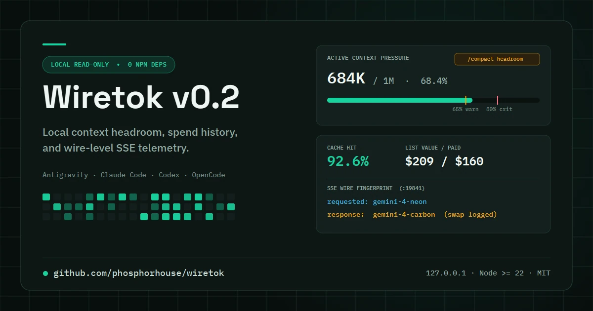
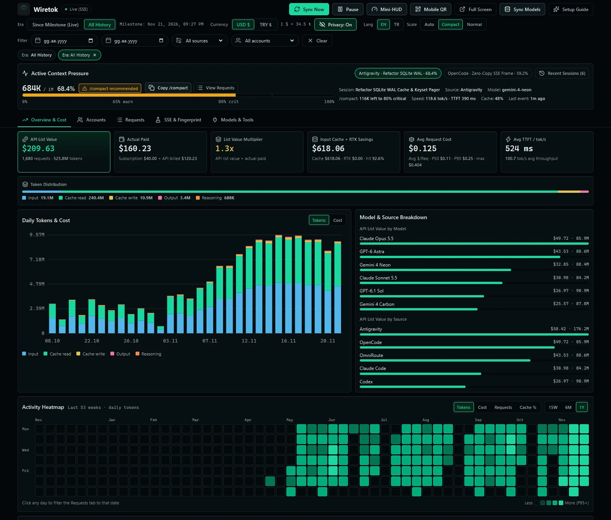
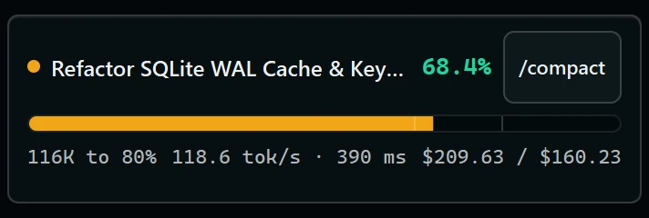
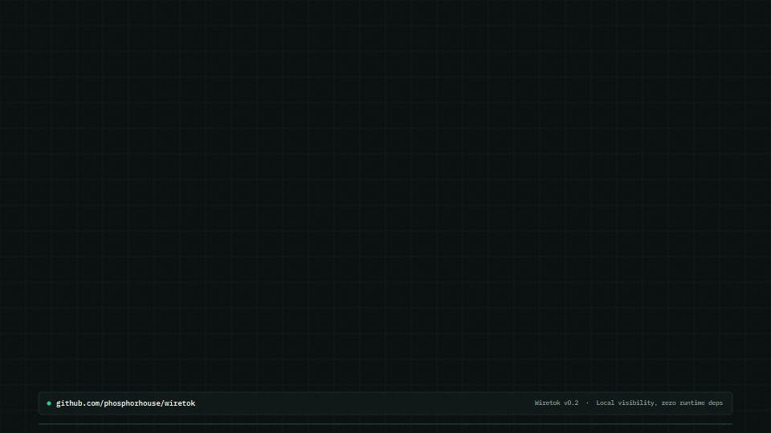

<div align="center">



# Wiretok

**Know where every token, cache hit, and dollar goes — locally, across every AI coding tool you run, without risking your account.**

[](https://nodejs.org/)
[](#why-zero-dependencies)
[](#zero-tos--local-first-security)
[](./LICENSE)

[Quickstart](#60-second-quickstart) · [Supported Tools](#supported-tools) · [Privacy & Zero-ToS](#zero-tos--local-first-security) · [Known Limitations & Roadmap](#known-limitations--roadmap)

</div>

---

If you bounce between **Antigravity 2.0**, **OpenCode**, **Claude Code**, **Codex CLI**, **OmniRoute**, and **9Router**, your usage is scattered across six different log formats, SQLite files, and billing models. You rarely notice a silent cache miss burning `$0.40` on a single turn, or a session creeping past compaction range — until the reply slows down or your quota resets.

**Wiretok** sits quietly on `127.0.0.1`, reads your local telemetry read-only, and gives you one honest view of context pressure, input cache efficiency, API list value vs. what you actually paid, per-request outliers, and live SSE wire behavior.

No cloud sync. No binary patches. Zero npm runtime packages.

<p align="center">
  
</p>

<p align="center">
  
  <br />
  <sub>Floating always-on-top Mini-HUD (<code>Document Picture-in-Picture</code> / <code>/?view=hud</code>) with live <code>Ctx %</code>, <code>/compact</code> headroom, and 1-click copy.</sub>
</p>

<p align="center">
  
  <br />
  <sub>Walkthrough: context headroom, spend &amp; cache history, and SSE wire check (<a href="./docs/assets/wiretok-demo.mp4">MP4 with audio</a>).</sub>
</p>

---

## What It Does

- **Live Context Pressure & Session Tracking:** Watch active sessions fill up with `65%` / `80%` headroom markers, click any recent session to pin and follow its metrics, filter the request log to that exact session in one click, and configure how many recent sessions stay visible (`3 | 6 | 12 | 24`).
- **Honest Dual-Layer Cost Accounting:** Separates **API List Value** from **Actual Paid** (`subscription fees + metered API spend`) and computes your **List Value Multiplier** (`API list value ÷ actual paid`) — never labeling estimated subscription usage as "profit". Auto-discovered CLI accounts start at `API ($0/mo)` with a 1-click `API | Sub | Free` switch per row.
- **GitHub-Style Activity Heatmap (`15W | 6M | 1Y`):** Switch live between `Tokens`, `Cost`, `Requests`, and `Cache %` across 371 days, hover for daily breakdowns, and click any cell to jump straight to that day's requests.
- **Display Scaling & Bilingual UI (`EN | TR`):** English by default with instant switching to Turkish. Viewport scale supports both **`Auto`** detection (crisp `Compact` density on `1920×1200` / `1080p` screens, spacious `Normal` on `2560×1600+`) and manual override.
- **Multi-Protocol SSE Lab & Local Pass-Through Proxy (`:19841`):** Inspect `/v1/responses` (`usage.attribution`, `instructions` vs. items waterfall), `/v1/messages` (thinking signatures), `/v1/chat/completions`, and Gemini streams — separating text self-reports from wire-level telemetry.
- **Antigravity 2.0 Native Sidecar + Opt-In Mobile LAN QR:** Docks directly inside Antigravity's aux pane (`sidecar://wiretok/panel/`), and optionally opens a 6-digit PIN-protected, read-only mobile view over local Wi-Fi.

*(Plus swarm/subagent cost trees, bulk history retagging, CSV/JSON export, live pricing sync, and a full CLI — explore them once it's running.)*

---

## Supported Tools

| Tool / Harness | Collection Method | What's Tracked Today |
| :--- | :--- | :--- |
| **Antigravity 2.0 / IDE / CLI** | Official plugin lifecycle hooks (`SessionStart`, `PreInvocation`, `PostInvocation`, `Stop`) + local metadata | Active vs. idle/killed sessions, subagent/swarm trees, context occupancy, tokens, cache reads |
| **OpenCode** | Local SQLite (`opencode.db`, dual v1 + v2 schema + compaction turns) | Per-message tokens, cache hits, compaction turns, part-level `TTFT` & tool-pause-excluded `tok/s` |
| **Claude Code** | Passive local session logs (read-only) | Input/output tokens, ephemeral cache read/write, session history |
| **OpenAI Codex CLI** | Passive local session files (read-only) | Token counters, reasoning tokens, context occupancy |
| **OmniRoute** | Local SQLite (strict non-secret column allowlist) | Per-connection token totals, provider costs, routing history |
| **9Router** | Local `/api/ingest` event receiver | Usage telemetry & per-request cost attribution |
| **Any OpenAI / Anthropic Client** | Optional local pass-through Tee Proxy (`http://127.0.0.1:19841/v1`) | Live streaming `TTFT`, `TPOT`, `tok/s`, and wire-level SSE fingerprints |

---

## 60-Second Quickstart

### Prerequisites
- **Node.js `>= 22.0.0`** (uses Node's built-in `node:sqlite` — no `node-gyp`, no native compilation, zero `npm install` needed).

### Run from Source

```bash
git clone https://github.com/phosphorhouse/wiretok.git
cd wiretok

# Optional: run the offline verification suite
npm test

# 1. Discover local tools and run the initial read-only sync
node --no-warnings bin/wiretok.mjs init

# 2. Start the local dashboard on http://127.0.0.1:19840
node --no-warnings bin/wiretok.mjs web --port 19840
```

**Windows 1-Click Launch:** Double-click `Wiretok Baslat.cmd` (starts detached in the background and opens your browser; stop anytime with `Wiretok Durdur.cmd`).

### Antigravity 2.0 Global Plugin (Update-Proof)

Register `plugins/` in `~/.gemini/config/plugins.json`:

```json
{
  "entries": [
    { "path": "C:/path/to/wiretok/plugins" }
  ]
}
```

Antigravity automatically picks up the hooks, agent skill, and the **Wiretok** sidecar panel — without modifying a single IDE file or breaking on Antigravity updates.

---

## Zero-ToS & Local-First Security

Wiretok is engineered so you can run it alongside commercial subscriptions and API keys with zero ban risk and zero credential leakage:

- **Zero binary or `.asar` patching:** Never modifies Antigravity binaries, `builtin/` assets, or internal app bundles.
- **Zero credential reads:** Explicitly blocks reading `oauth_creds.json`, `.credentials.json`, `auth.json`, browser cookies, or router secret columns (`access_token`, `refresh_token`, `api_key`, `id_token`).
- **No traffic MITM on official desktop apps:** Never intercepts Google or Anthropic internal IDE traffic.
- **Privacy mask ON by default:** Emails (`a***e@example.com`) and OS user paths (`C:\Users\<user>\...`) are masked in the UI and forced ON for LAN viewers.
- **Loopback-only by default:** Binds strictly to `127.0.0.1`. Opt-in Mobile LAN mode requires a 6-digit CSPRNG PIN (`timingSafeEqual`, 5-attempt lockout -> `429`), signed `HttpOnly; SameSite=Strict` cookies, and permanently locks write/proxy/integration endpoints to loopback.
- **Isolated data directory:** Runtime SQLite and JSONL files live in `~/.wiretok/`, completely outside the repo.

See [SECURITY.md](./SECURITY.md) for full details on SSRF `net.BlockList` rules, prototype-pollution guards, and header scrubbing.

---

## Why Zero Dependencies?

Everything runs on native Node 22+ standard library APIs (`node:sqlite`, `node:http`, `node:crypto`, `node:net`) and vanilla ES2022 DOM APIs with zero `.innerHTML` sinks. Nothing to compile, minimal supply-chain risk, and cold starts under a second.

---

## Known Limitations & Roadmap

Wiretok is at **v0.2** — useful every day, with clear rough edges we are actively working on:

- **`tok/s` and `TTFT` accuracy on passive logs:** Many harnesses only persist aggregate turn timestamps rather than first-token / per-chunk timestamps. As a result, `tok/s` can read artificially high or low and `TTFT` can be missing (`—`) on passively imported logs. Live capture (`:19841` Tee Proxy), the Speed Benchmark, and OpenCode part-level timings are more accurate today; better passive estimation and cleaner telemetry hooks are planned.
- **Simpler SSE Forensics Lab:** Streamlining the lab workflow with faster test API entry plus built-in one-click probes for knowledge cutoff verification, model token-accounting behavior, and thinking-signature validation.
- **Configurable compaction thresholds:** The context bar currently uses static `65%` / `80%` marks against the model's nominal window. Real harnesses often compact earlier — for example, Antigravity appears to trigger compaction around **~507K–512K tokens** on Gemini models. Per-harness and per-model compaction threshold settings are next.
- **More languages & themes:** Currently supports **English** (default) and **Turkish** (`EN | TR`) in a single dark telemetry theme. Adding Simplified Chinese (`zh-CN`), additional locales via [`ui/i18n.js`](./ui/i18n.js), and light/custom themes is on the roadmap.
- **Broader harness coverage:** Adding passive collectors for additional desktop/CLI AI clients (Cherry Studio, Cline / Roo Code, Cursor, Aider, etc.).

PRs and collector contributions are welcome — see [CONTRIBUTING.md](./CONTRIBUTING.md).

---

## CLI Quick Reference

```bash
node --no-warnings bin/wiretok.mjs status --era live     # Summary tokens, cache hit %, list vs. paid cost
node --no-warnings bin/wiretok.mjs today                 # Today's spend & throughput
node --no-warnings bin/wiretok.mjs live                  # Active sessions, context % & /compact headroom
node --no-warnings bin/wiretok.mjs accounts --era all    # Per-account usage & plan breakdown
node --no-warnings bin/wiretok.mjs sync --all            # Run incremental sync across all local tools
node --no-warnings bin/wiretok.mjs sync-models           # Refresh model pricing & context catalog
node --no-warnings bin/wiretok.mjs web --port 19840      # Launch local dashboard (add --lan for PIN QR)
```

---

<details>
<summary><b>Türkçe Özet</b></summary>

**Wiretok**, Antigravity 2.0, OpenCode, Claude Code, Codex CLI, OmniRoute ve 9Router kullanımlarınızı tamamen yerel olarak (`127.0.0.1`) takip eden sıfır bağımlılıklı bağlam baskısı, token, input cache, hız ve maliyet konsoludur. Hiçbir OAuth/API anahtarını okumaz, IDE ikililerine dokunmaz ve ToS/ban riski oluşturmaz. Üst çubuktaki **Lang (`EN | TR`)** düğmesiyle arayüzü anında Türkçeye, **Scale (`Auto | Compact | Normal`)** düğmesiyle `1920×1200` ve `2560×1600` ekranlara göre ölçeklemeye geçirebilirsiniz.

</details>

---

MIT Licensed — see [LICENSE](./LICENSE).
